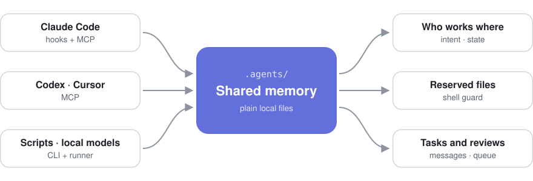

<p align="center">
  <picture>
    <source media="(prefers-color-scheme: dark)" srcset="docs/logo-dark.svg">
    
  </picture>
</p>

<h1 align="center">Agent Shared Memory</h1>

<p align="center">
  <strong>One shared memory for a team of coding agents.</strong><br>
  Several agents in one repository see who is working where, reserve files, stop each other from
  overwriting work, and read code by symbol instead of whole files.
</p>

<p align="center">
  
  
  
  
  
</p>

<p align="center">
  <a href="#quick-start">Quick start</a> ·
  <a href="#features">Features</a> ·
  <a href="#how-it-works">How it works</a> ·
  <a href="#measured-results">Results</a> ·
  <a href="#documentation">Documentation</a> ·
  <a href="README.pt-BR.md">Português</a>
</p>

---

## Why

When several AI coding agents work in the same codebase, Git conflicts are the small problem. The
bigger one is that no agent knows what the others are doing: which file another one is about to
change, what already changed, who is waiting for whom, whether a task is still open, or whether a
review really happened. The usual result is two agents rewriting the same file, or one switching the
branch under the other.

Agent Shared Memory is a small coordination layer that lives next to your code, in plain files
under `.agents/`. No server, no database, no account: every agent, whatever its vendor, reads and
writes the same memory.

## Features

| | |
|---|---|
| **Shared, live memory** | Every agent declares what it will change, and why, before it starts. All of them see the current state of the others: in the terminal, over MCP, or on a live dashboard. |
| **File reservations** | Claim files, folders or globs for a while, exclusive or shared. Writes from other agents are refused before they happen, in the editor hooks and at commit. |
| **Shell guard** *(new in 1.5.0)* | A `git checkout`, `stash`, `reset`, `pull` or `add -A` in a folder where another session has unsaved work is stopped, with the files and the session named. |
| **Code by symbol** | Read, find, edit and rename one function or class by name (`file::Type.member`), without a language server. Fewer tokens, and two agents can change two functions of one file safely. |
| **Work queue and reviews** | Durable tasks with priorities, dependencies, retries and review gates; work is never reviewed by the agent that did it. A runner executes any CLI agent or script, one task at a time. |
| **Any agent, any machine** | One command sets up Claude Code (hooks and MCP). Codex, Cursor, Ollama-based runners and scripts use MCP or the CLI. A hub shares one memory between machines. |

## How it works

<p align="center">
  <picture>
    <source media="(prefers-color-scheme: dark)" srcset="docs/how-it-works-dark.svg">
    
  </picture>
</p>

Every agent follows one loop:

1. **Read** the shared memory: who is active and where, which files are reserved, what is ready to do.
2. **Declare intent** with a pointer such as `src/auth/token.ts::TokenService.refresh`, before editing.
3. **Code.** Overlaps are reported at once; reserved files and risky git commands are refused.
4. **Record the result** (`CHANGED`, `TESTING`, `DONE`), which the other agents see right away.

With Claude Code the loop runs by itself: `setup claude` installs hooks that brief each session when
it starts and check every edit and shell command.

## Quick start

Requirements: Node.js 20 or newer, and Git.

```bash
git clone https://github.com/jardelva96/agent-shared-memory.git
cd agent-shared-memory
npm install
npm run build
npm link            # makes the agent-memory command available
```

In the project the agents will share:

```bash
cd /path/to/your/project
agent-memory init --name "My Project"
agent-memory setup claude    # Claude Code: hooks and MCP server in one step
agent-memory serve           # live dashboard at http://127.0.0.1:4317
```

Any other agent registers with its own id and declares what it is about to do:

```bash
agent-memory register --agent AGENT-02 --role Frontend --task UI-210
agent-memory intent --agent AGENT-02 --task UI-210 \
  --pointer "src/app/page.tsx::HomePage" \
  --message "Update the empty state on the home page"
agent-memory status
```

Without `npm link`, run any command with `npm run dev -- <command>`.

## Measured results

Every number comes from the `bench/` folder and can be run again:

| What | Result |
|---|---|
| Two agents changing two functions of one file at once (8 races, free models) | whole-file writes erased the other's work 3 of 7 times; by symbol, 0 of 8, with 96% of hidden tests passing against 73%, and 46% fewer tokens |
| Reading by pointer instead of whole files (213 runs, 10 models) | same answers right, 66% fewer tokens |
| Finding code when only the name is known: text search against the symbol tools (40 runs) | same answers right, 75% fewer tokens with the symbol tools |
| Pointer returns exactly the declaration asked for (9,400 declarations, against the compilers) | C# 99.4%, TypeScript 99.3%, Python 98.8% |
| File outline against the compilers | finds 98.5% to 99.96% of declarations; 99.6% to 100% of what it lists is real |
| Queue with four agents from two providers | no task claimed twice, no self-review, no dependency skipped, in 40 audited runs |
| One write to the memory, with 8,000 events in the journal | 13 ms |
| Claiming a task with 3,000 tasks on disk | 27 ms |
| Finding a symbol across 609 files (8.7 MB) | 0.15 s |
| 40 agent processes writing at once | about 120 writes/s, no event lost, no file corrupted, panel up to date |

## Documentation

[Feature details](#feature-details) ·
[Project layout](#project-layout) ·
[Principles](#principles) ·
[Initialize another project](#initialize-another-project) ·
[Register agents](#register-agents) ·
[Recommended workflow](#recommended-workflow) ·
[Agent lifecycle](#agent-lifecycle) ·
[Event journal](#event-journal) ·
[Compaction](#compaction) ·
[Waiting and messages](#waiting-and-messages) ·
[Heartbeat](#heartbeat) ·
[Shell guard](#shell-guard) ·
[Conflict detection](#conflict-detection) ·
[Work queue, runner and scheduling](#work-queue-runner-and-scheduling) ·
[Git watcher](#git-watcher) ·
[Local dashboard](#local-dashboard) ·
[MCP server](#mcp-server) ·
[Pointer format](#pointer-format) ·
[Prompt protocol](#prompt-protocol) ·
[Commands](#commands) ·
[Concurrency](#concurrency) ·
[Tests](#tests)

## Feature Details

- **One command for Claude Code.** `agent-memory setup claude` installs hooks and the MCP
  server: every session starts with a briefing (`prime`), a write to a file another agent
  reserved is refused before it happens, and every write tells the other agents on that file
  that their copy is stale. `agent-memory setup git` adds a pre-commit guard.
- **Reserved files.** `agent-memory reserve --agent A src/auth/` claims files, folders or globs
  for a limited time, exclusive or shared, all or nothing. Others are refused at write time and
  at commit; reservations expire on their own.
- **Edit by symbol, safely.** `memory_replace_symbol` changes one function, method or class in
  place. The file is re-read under a lock when the edit applies, so two agents changing two
  functions of one file both keep their work, and an edit that would break the file's syntax is
  refused with the line, before anything is written.
- **Read by symbol, without a language server.** `symbols <file>`, `find <Name|Type.member>`,
  `refs <Name>`, `rename <Name> <NewName>` (a plan first, `--apply` to write), and
  `memory_read_pointer "file::Type.member"`. Works in TypeScript, JavaScript, Python, C#, Java,
  Go and more, with nothing else installed.
- **Several machines, live.** `agent-memory hub` shares one memory over the network with a
  token; on the other machines set `AGENT_MEMORY_REMOTE` and `AGENT_MEMORY_TOKEN`. A file
  reserved on one machine is refused on another the moment it is granted. Code is still read
  and edited locally.
- **Agents from any vendor in one queue,** with priorities (`--priority 0-4`), dependencies,
  `task ready`, `task show` (the whole story of a task) and reviews that never go to the agent
  that did the work, decided by majority when you ask for a panel.

## Project Layout

`agent-memory init` creates this folder in the project:

```text
.agents/
├── SHARED_MEMORY.md       # central generated view of current activity
├── config.json
├── state/
│   ├── AGENT-01.json      # structured current state
│   └── AGENT-02.json
├── history/
│   ├── AGENT-01.md        # per-agent append-only history
│   ├── AGENT-02.md
│   └── archive/           # rotated histories from compact --history
├── events/
│   ├── events.jsonl       # global event journal
│   └── archive/           # old events created by compact
├── inbox/
│   ├── AGENT-02.jsonl     # messages addressed to the agent
│   └── AGENT-02.cursor.json
├── tasks/
│   ├── T-XXXX.json        # durable work queue
│   └── archive/           # old closed tasks
├── schedules/
│   └── S-XXXX.json        # cron schedules
├── reservations.json      # files reserved by agents
├── facts.json             # facts every session starts with
└── .locks/                # internal write locks
```

## Principles

1. Every agent reads shared memory before a meaningful change.
2. Every agent records `INTENT` before editing code.
3. After work, the agent records `CHANGED`, `CREATED`, `TESTING`, `FOUND`, `WAITING` or `DONE`.
4. Pointers use file + symbol + optional parameter instead of fragile line numbers.
5. Each agent owns a separate history.
6. The central memory file is generated and should not be edited manually.
7. Overlapping intent is a warning, not a lock; only reserved files and the shell guard refuse a change.

## Initialize Another Project

Enter the repository that should be coordinated:

```bash
cd my-backend
agent-memory init --name "My Backend"
```

Or pass the root explicitly:

```bash
agent-memory init --root /path/to/my-backend --name "My Backend"
```

## Register Agents

```bash
agent-memory register \
  --agent AGENT-01 \
  --role Backend \
  --task AUTH-184

agent-memory register \
  --agent AGENT-02 \
  --role Backend \
  --task ORD-191
```

## Recommended Workflow

### 1. Read Current State

```bash
agent-memory status
```

or:

```bash
agent-memory memory
```

### 2. Declare Intent

```bash
agent-memory intent \
  --agent AGENT-01 \
  --task AUTH-184 \
  --pointer "src/Auth/TokenService.cs::TokenService.ValidateRefreshToken(string refreshToken)" \
  --message "Add expiration validation for refresh tokens" \
  --reason "Expired refresh tokens are still accepted"
```

### 3. Record The Change

```bash
agent-memory changed \
  --agent AGENT-01 \
  --pointer "src/Auth/TokenService.cs::TokenService.ValidateRefreshToken(string refreshToken)" \
  --message "expiresAt validation added; expired tokens are now rejected"
```

### 4. Record Testing

```bash
agent-memory testing \
  --agent AGENT-01 \
  --pointer "tests/Auth/TokenServiceTests.cs::ExpiredRefreshToken_ShouldFail()" \
  --message "Regression test added and passing"
```

### 5. Finish

```bash
agent-memory done \
  --agent AGENT-01 \
  --message "AUTH-184 completed; validation and tests are passing"
```

## Agent Lifecycle

### Agent Ids

An id may contain letters, digits, dots, dashes and underscores, and must contain at least one letter
or digit. Any other value is rejected instead of sanitized.

This is deliberate: the id becomes a filename. If `AGENT/01` were sanitized into `AGENT-01`, both
would share state, history and inbox files, and `unregister("AGENT/01")` could remove the wrong
agent. Rejecting invalid ids is the only reliable way to keep one agent's data separate from
another's.

Ids are exclusive: registering an existing id fails, so two agents do not accidentally share state.

When an agent process restarts, use `--force` to open a fresh session while preserving history:

```bash
agent-memory register --agent AGENT-01 --force
```

When an agent exits permanently, remove it from the panel:

```bash
agent-memory unregister --agent AGENT-01
```

`unregister` removes only current state. History stays as an audit trail, and the journal receives
an `UNREGISTERED` event. If the same id is registered later, the previous history is kept and the new
session is appended below a separator.

## Event Journal

```bash
agent-memory log --limit 20
agent-memory log --agent AGENT-01
agent-memory log --json
```

## Compaction

The journal is archived automatically after `autoCompactAfterEvents` events, keeping the newest half
live. The default is 5000:

```bash
agent-memory config --auto-compact 5000   # 0 disables it
```

Compaction also keeps writes fast. Every write regenerates the dashboard memory, and regeneration reads the live
journal. Without compaction, write latency grew from 6.8 ms at 2,000 events to 12.7 ms at 40,000 and
kept rising. With compaction enabled, it stays around 6 ms because the live journal stabilizes.

Manual compaction archives old records instead of deleting them:

```bash
agent-memory compact --keep 500 --dry-run
agent-memory compact --keep 500
agent-memory compact --keep 500 --history
```

## Waiting And Messages

```bash
agent-memory waiting \
  --agent AGENT-03 \
  --for AGENT-02 \
  --pointer "src/Payments/RefundService.cs::RefundService.CreateRefund()" \
  --message "Waiting for CancelAsync() before integrating refunds"

agent-memory send \
  --from AGENT-02 \
  --to AGENT-03 \
  --message "CancelAsync is done; refund integration can continue" \
  --pointer "src/Orders/OrderService.cs::OrderService.CancelAsync(Guid orderId)"

agent-memory inbox --agent AGENT-03            # unread messages, then marks them read
agent-memory inbox --agent AGENT-03 --peek     # read without marking
agent-memory inbox --agent AGENT-03 --all      # full inbox
```

Every recipient has an append-only queue in `.agents/inbox/`, with a separate cursor recording the
last acknowledged message. Unread counts appear in `status`, MCP `memory_status`, and the dashboard.

## Heartbeat

```bash
agent-memory heartbeat --agent AGENT-01
agent-memory config --stale 120
```

By default, an agent with no heartbeat or activity for more than 60 seconds appears as `OFFLINE`.

## Shell Guard

Branch switches and edits made through the shell bypass the editor hooks, so `setup claude` also
installs `pre-shell` and `post-shell` hooks on Bash and PowerShell. They note which checkout each
session works in (following `cd`, `Set-Location` and `git -C`) and which files its own commands
wrote.

A git command that moves a checkout (`checkout`, `switch`, `stash`, `reset`, `restore`, `pull`,
`merge`, `rebase`, `clean`, `cherry-pick`, `revert`, `am`) or sweeps everything into a commit
(`add -A`, `add .`, `commit -a`) is refused while another session works in that checkout and
there are recent uncommitted changes this session did not make, or while another session just
moved the branch:

```text
`git checkout -b fix/x origin/prod` would change the checkout app while another session works in it.
Uncommitted changes this session did not make, from the last 30 min:
  src/Pages/Senha.cshtml (4 min ago)
Sessions seen in app: CC-9B000001 (shell, 2 min ago: cd && dotnet).
```

When the changes are yours, end the command with `# asm-ok: <why>`; it goes through and the reason
is kept. `agent-memory guard-log` lists every block and every asm-ok, and whether each asm-ok was
needed, which helps tune the guard for a team. `guardMinutes` in `.agents/config.json`
sets the window (default 30; 0 turns the guard off), and `primeRules` replaces the default rules of
the session briefing. `setup claude --hooks-only` skips the MCP server.

A session that closes without SessionEnd (an editor window closed, a crash) would stay on the panel
forever. When a session starts, sessions silent for longer than `forgetOfflineAfterHours` (default
24; 0 keeps them all) that hold no claimed task and no reservation are forgotten, at most once an
hour; their history stays. `agent-memory forget-idle` runs that sweep now.

## Conflict Detection

If `AGENT-01` is working on:

```text
src/Orders/OrderService.cs::OrderService.CancelAsync(Guid orderId)
```

and `AGENT-05` declares intent on the same symbol, the command records the action and prints a
warning:

```text
WARNING: 1 active overlap(s) detected:
- AGENT-01 [WORKING] EXACT src/Orders/OrderService.cs -> OrderService.CancelAsync(Guid orderId)
```

The goal is shared awareness, not a hard lock. To see every active overlap in the project,
use the dashboard or `GET /api/snapshot`.

## Work Queue, Runner And Scheduling

A task stays in the queue until an agent claims and finishes it. Tasks are the durable way to
delegate work across sessions and tools:

```bash
agent-memory task create --agent AGENT-01 --title "Document parseArgs" \
  --detail "Explain the new flag order" --pointer "README.md"
agent-memory task create --agent AGENT-01 --title "Review auth" --for AGENT-02

agent-memory task list [--status OPEN] [--json]
agent-memory task claim --agent AGENT-02
agent-memory task done --id T-XXXX --message "README updated"
agent-memory task fail --id T-XXXX --message "missing credential"
```

### Review Gates

`--review-by` separates implementation from judgment:

```bash
agent-memory task create --agent LEAD --for DEV --review-by QA \
  --title "Implement median(list)" --detail "..."
```

If review fails, the work returns to the queue with the objection appended to `detail`, and a fresh
review is queued for the next round.

When any capable agent may review, use `--review`. For expensive or risky work, use `--reviewers N`
to create an open panel of 1 to 9 reviewers and decide by majority:

```bash
agent-memory task create --agent LEAD --for DEV --reviewers 3 \
  --title "Migrate billing" --detail "Requires a majority before closing"
```

Each panel seat must be claimed by a different agent, and the implementer can never review its own
work. If a majority rejects, undecided seats are cancelled and the work returns to the queue.

### Split Work And Join It Back

`--depends-on` keeps a task out of the queue until all dependencies are `DONE`:

```bash
id() { node -pe "JSON.parse(require('fs').readFileSync(0)).id"; }
A=$(agent-memory task create --agent LEAD --for W1 --title "part A" --json | id)
B=$(agent-memory task create --agent LEAD --for W2 --title "part B" --json | id)

agent-memory task create --agent LEAD --for REV --depends-on "$A,$B" \
  --title "Review the combined result"
```

The agent claiming the synthesis receives the results of the completed parts along with the claim.

### Runner

```bash
agent-memory run --agent AGENT-03 --exec "my-script.sh" --once
agent-memory run --agent AGENT-03 --exec "my-script.sh" --once --max-tasks 1
agent-memory run --agent AGENT-03 --exec "claude -p \"$AGENT_TASK_DETAIL\""
```

`--once` runs every ready task, then exits; `--max-tasks N` stops after N tasks. Without `--once`
the runner keeps waiting for new work.

Task content never enters the command string. Title, detail and pointer arrive through environment
variables:

```text
AGENT_ID  AGENT_MEMORY_ROOT  AGENT_TASK_ID  AGENT_TASK_TITLE
AGENT_TASK_DETAIL  AGENT_TASK_POINTER  AGENT_TASK_POINTER_FILE
AGENT_TASK_DEPTH  AGENT_TASK_ATTEMPT
```

Exit 0 completes the task. Any other exit code marks it `FAILED` and stores output. A stuck command
is killed by `--timeout` together with its process tree.

### Ready-To-Use Executors

```bash
TASK_AGENT_CMD="claude -p" \
  agent-memory run --agent WORKER --exec "node examples/task-agent.mjs"

agent-memory run --agent WORKER --exec "node examples/task-agent-ollama.mjs"
```

Both read the task from the environment, write the deliverable to `outputs/<id>.md`, and exit 0 or
1 so the queue can mark the task `DONE` or `FAILED`.

### Scheduling

```bash
agent-memory schedule create --agent AGENT-01 --cron "0 9 * * 1-5" \
  --title "Daily dependency scan"
agent-memory schedule list
agent-memory scheduler --interval 30
agent-memory scheduler --once
```

The cron parser supports five fields with `*`, `n`, `a-b`, `a,b,c` and steps. Multiple schedulers
can run together because due schedule materialization is serialized under a lock.

### Closed Tasks Are Archived

Once more than `maxClosedTasks` closed tasks (default 200) sit in `.agents/tasks/`, the oldest
move to `.agents/tasks/archive/`, so the queue stays fast however long the project runs. A closed
task that open work still points at (a dependency, the work under an open review) stays. Archived
tasks are still read by id, still satisfy dependencies, and are listed with `task list --all` or
when asking for a closed status (`task list --status DONE`).

### Limits Against Runaway Spawning

Any task created during another task inherits depth + 1, and exceeding `maxTaskDepth` rejects it.
The default is 3. A claim expires after `taskClaimSeconds`, defaulting to 900 seconds; if the runner
dies, the task returns to the pool with an incremented attempt count.

## Git Watcher

The watcher compares the Git working tree with declared agent intent:

```bash
agent-memory watch
agent-memory watch --interval 5
agent-memory watch --once
agent-memory watch --dry-run
```

Each changed file is attributed to the agent pointing at it, either through the current pointer or
the recent journal:

```text
AGENT-01               src/Auth.cs (modified +2/-0)
UNDECLARED             src/Orders.cs (modified +1/-0)
AMBIGUOUS(A-01|A-02)   src/Shared.cs (modified +3/-1)
```

Attribution is deliberately conservative. Ownership exists only when exactly one agent claims the
file. The `.agents/` directory is always ignored.

## Local Dashboard

```bash
agent-memory serve
```

Open:

```text
http://127.0.0.1:4317
```

The dashboard updates through SSE and shows agents, effective status, current tasks, active
overlaps, recent activity and inbox counts.

Endpoints:

```text
GET /events         SSE snapshot stream
GET /api/snapshot   same payload, once
GET /api/status     agent state in the original format
GET /api/memory     SHARED_MEMORY.md
```

## MCP Server

Expose memory as native MCP tools over stdio:

```bash
agent-memory mcp --root /path/to/my-backend
agent-memory mcp --root /path/to/my-backend --agent AGENT-01
```

With a pinned `--agent` id, the server registers or reattaches that agent at startup, removes the
`agent` parameter from tool schemas, and prevents caller-side impersonation.

Most MCP clients use this `.mcp.json` shape:

```json
{
  "mcpServers": {
    "agent-memory": {
      "command": "agent-memory",
      "args": ["mcp", "--root", "/path/to/my-backend", "--agent", "AGENT-01"]
    }
  }
}
```

### Exposed Tools

| Tool | Use |
| --- | --- |
| `memory_status` | Current state of all agents. Accepts `pointer` to check overlap before declaring intent. |
| `memory_read` | Full `SHARED_MEMORY.md`. |
| `memory_read_pointer` | Reads only the symbol named by a pointer, not the full file. |
| `memory_register` | Registers or reattaches an agent. |
| `memory_record` | Records `INTENT`, `READING`, `FOUND`, `CHANGED`, `CREATED`, `TESTING`, `WAITING`, `NOTE` or `DONE`. |
| `memory_task_create` | Queues durable work for another agent. |
| `memory_task_list` | Lists the queue. |
| `memory_task_claim` | Claims the oldest available task. |
| `memory_task_finish` | Closes a task as DONE, FAILED or CANCELLED. |
| `memory_send` | Sends a message to another agent. |
| `memory_inbox` | Reads an agent inbox. Supports `peek` and `all`. |
| `memory_heartbeat` | Refreshes presence during long work. |
| `memory_log` | Reads recent global journal events, optionally filtered by agent. |
| `memory_prime` | Start-of-session briefing: rules, project facts, who is active, reserved files, ready work, unread messages. |
| `memory_task_ready` | Tasks this agent could claim now, most urgent first. |
| `memory_task_show` | One task with its reviews, verdicts and every journal entry that names it. |
| `memory_reserve` | Reserves files, folders or globs, exclusive or shared, all or nothing, for a limited time. |
| `memory_release` | Releases this agent's reservations. |
| `memory_reservations` | Lists the files reserved right now. |
| `memory_remember` | Stores a short fact every session starts with. |
| `memory_symbols` | Lists what a file declares, with line ranges, without reading it. |
| `memory_find_symbol` | Finds where a symbol is declared in the project; `Type.member` narrows it. |
| `memory_references` | Finds the lines that use a symbol, outside strings and comments. |
| `memory_replace_symbol` | Replaces one function, method, class or property in place, under a lock, refusing code that breaks the file's syntax. |
| `memory_insert_symbol` | Inserts new code right after or before an existing symbol, with the same safety. |
| `memory_rename` | Renames a symbol across the project: a plan first, `apply` to write. |

The `initialize` handshake returns the protocol instructions, so the agent receives the
`READ -> INTENT -> CODE -> RESULT` rule without needing `AGENT_PROTOCOL.md` in the system prompt.

## Pointer Format

```text
file::symbol::parameter
```

Examples:

```text
src/Auth/TokenService.cs::TokenService.ValidateRefreshToken(string refreshToken)
src/Orders/OrderService.cs::OrderService.CancelAsync(Guid orderId)::orderId
src/Customers/CustomerRepository.cs
```

`memory_read_pointer` returns the named symbol instead of the whole file. Extraction is heuristic,
not a full parser: balanced braces for C-like languages, indentation for Python, and no result
instead of a confident wrong slice when the symbol is not found. Reads are resolved under the
project root.

## Prompt Protocol

Use [AGENT_PROTOCOL.md](AGENT_PROTOCOL.md) in each agent's system prompt or instructions when MCP is
not available. The main rule is:

```text
READ -> INTENT -> CODE -> RESULT -> READ
```

With MCP, this is optional because the server returns the protocol during `initialize`.

## Commands

```text
init        Initialize .agents/
register    Register an agent and open its history (--force starts a new session)
unregister  Remove an agent from the panel while preserving history
forget-idle Forget sessions silent for longer than forgetOfflineAfterHours
status      Show a compact agent status table
memory      Print SHARED_MEMORY.md
log         List recent journal events
send        Send a message to another agent
inbox       Read messages addressed to an agent
heartbeat   Refresh agent presence
intent      Declare planned work before editing
reading     Record code reading or analysis
found       Record a relevant finding
changed     Record changed code
created     Record created code/files
testing     Record tests in progress or completed
waiting     Record a dependency or wait
note        Record an operational note
done        Finish the current task/action
task        Queue, list, claim and finish work
schedule    Create and list cron schedules
run         Runner: claim tasks and execute one command per task
scheduler   Materialize due scheduled tasks
config      Read or update configuration
compact     Archive old journal and history data
watch       Compare Git working tree changes with declared intent
serve       Start the local dashboard
mcp         Start the stdio MCP server
prime       Start-of-session briefing
reserve     Reserve files, folders or globs (release, reservations)
remember    Store a project fact (facts, forget)
symbols     List what a file declares
find        Find where a symbol is declared
refs        Find where a symbol is used
rename      Rename a symbol across the project (--apply to write)
setup       Install Claude Code hooks and MCP (setup claude) or the git guard (setup git)
guard-log   List what the shell guard blocked or let through
hook        Entry point the hooks call
hub         Share this memory with other machines over HTTP
```

## Concurrency

Each agent runs in its own process and writes to the same `.agents/` directory.

- Each `state/AGENT-X.json` write is atomic.
- Each individual history has its own lock.
- `events.jsonl` uses a short global lock only for appends.
- `SHARED_MEMORY.md` is regenerated by one process at a time and written atomically. A write that
  finds it being regenerated leaves a mark and moves on; the regenerating process renders again,
  and a read renders first when a mark is left.
- Agents never need to edit the central file manually.
- Abandoned locks are recovered after 30 seconds.
- Lock contention is treated as waiting, not failure.
- Dashboard regeneration never invalidates the write that came before it.

Measured with real concurrent processes, from zero to 40 agents x 25 activities, the project kept
1,040 events without lost events, corrupted files, contaminated histories or stuck locks, and the
panel ended up to date. Throughput under 40 simultaneous processes is about 120 writes/s (60 before
1.4.0, when every write waited its turn to regenerate the panel).

## Tests

```bash
npm test
```

## Automatic Example

```bash
npm run example
```

The example creates a temporary project, registers three agents and simulates conflict and
dependency.

## Possible Future Work

- VS Code extension;
- AST/LSP pointer resolution instead of semantic strings only;
- dependency detection between symbols;
- worktree and branch integration.

## License

MIT. See [LICENSE](LICENSE).
